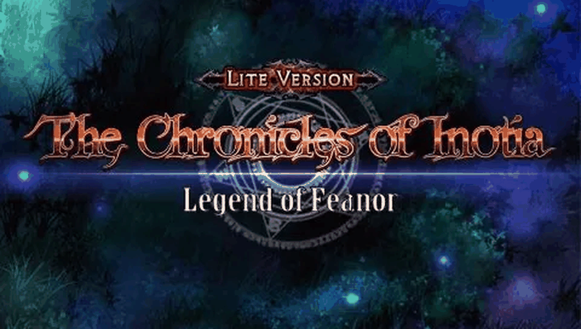

<h1 align="center">
  <br>
  The Chronicles of Inotia: Legend of Feanor · PS Vita Port
</h1>

<p align="center">
  <a href="#-status--playability">Status & Playability</a> •
  <a href="#setup-instructions-for-players">How to install</a> •
  <a href="#controls">Controls</a> •
  <a href="#known-issues">Known Issues</a> •
  <a href="#build-instructions-for-developers">How to compile</a> •
  <a href="#credits--acknowledgments">Credits</a>
</p>

An unofficial, native **iOS-to-PS Vita wrapper port** of *The Chronicles of Inotia: Legend of Feanor* (originally developed by **Com2uS**). There is no ELF here: this port ships its own **Mach-O loader** that maps the official iPhone OS 2.2 ARMv6 executable (`feanor2i`, from the 1.0.4 IPA) into PS Vita RAM and replaces the Apple frameworks it uses (Foundation, UIKit, CoreGraphics, AudioToolbox, OpenAL, MediaPlayer) with native implementations on top of **vitaGL**, **FreeType**, **FFmpeg** and the Vita system libraries.

---

## 🎮 Status & Playability

**Status: PLAYABLE (v0.1.0)**

The game plays its intro video, reaches the title screen and menus, and is playable in-game on physical PlayStation Vita hardware.

- [x] **Mach-O loader**: maps the image at `0x98000000` (`MACHO_SLIDE`), applies 6,279 rebase words, resolves 314 import slots (0 unimplemented) and registers the game's 6 Objective-C classes on a mini ObjC runtime. *Verified on console.*
- [x] **Graphics**: the game renders in software into a 320×480 CoreGraphics bitmap (`-[MyView drawRect:]`); the loader uploads it as a vitaGL texture, rotated to landscape and scaled to 816×544 (original 3:2 aspect). *Verified on console.*
- [x] **Text & Fonts**: UIKit/CoreGraphics text is rendered with FreeType: NanumGothic for Latin/Korean, plus a DejaVu Sans fallback for accented characters (á é í ó ú ñ ü…). Spanish text displays complete. *Verified on console.*
- [x] **Intro video**: `Feanor2i.mp4` plays through FFmpeg software decoding with sound; Cross/Start skips it. *Verified on console.*
- [x] **Performance**: the WIPI engine's own frame timers (`SetTimer(10)`) are serviced every 4 ms, so frames are no longer dropped to 10 FPS. *Verified on console.*
- [x] **Audio**: music (AudioQueue) and sound effects (OpenAL) play through `sceAudioOut`. The music thread runs at a higher priority on its own core to avoid cuts.
- [x] **Saves**: progress is written to `ux0:data/feanor/Documents/` (fixed a crash when saving).
- [x] **Pause**: Start / Select suspend and resume the game through its own `applicationWillResignActive:` / `applicationDidBecomeActive:` handlers.

---

## Disclaimer

**The Chronicles of Inotia: Legend of Feanor** is a registered trademark of **Com2uS**. The work presented in this repository is unofficial and is not produced, endorsed, or sanctioned by Com2uS or any affiliated entities.

This software does NOT contain original game code, binaries, copyrighted graphics, or game assets. The authors do not promote or condone piracy in any way. To play, you must provide your own legally obtained, **decrypted** copy of the iOS `.ipa`.

---

## Setup Instructions (For Players)

1. **CFW & Plugins**: PS Vita on Custom Firmware (**Enso 3.60 / 3.65** recommended) with `kubridge` under `*KERNEL` in `ur0:tai/config.txt`:
   ```ini
   *KERNEL
   ur0:tai/kubridge.skprx
   ```
2. **Shader Compiler**: `libshacccg.suprx` must be in `ur0:data/` (extract it with **ShaRKBR33D**).
3. **Game Files**: a decrypted **Inotia: Legend of Feanor 1.0.4** iOS `.ipa` (FairPlay `cryptid 0`). Open it as a ZIP and extract `Payload/feanor2i.app/`.
4. **Prepare the data** on a computer (macOS, Python 3 and `ffmpeg` required) with `tools/stage_feanor.sh` from this repository (see [Build Instructions](#build-instructions-for-developers)). It copies the app, generates `rebase.bin` / `binds.bin`, converts `Info.plist` to binary and converts the intro video to MPEG-4 Part 2 (the Vita's FFmpeg build has no H.264 decoder).
5. **Copy to the Vita** (`ux0:data/feanor/`):
   ```
   ux0:data/feanor/
     game_app/       the feanor2i.app contents (staged)
     rebase.bin      absolute pointers to relocate
     binds.bin       Apple framework import slots
     nib.txt, nibs/  MainWindow.nib, pre-parsed
     Feanor2i.mp4    converted intro video
     controls.txt    button -> touch mapping (editable)
     font.ttf, font_latin.ttf
     Documents/      created automatically — your save games
     logs/           created automatically — feanor_001.log … one per run
   ```
6. **Install VPK**: install `feanor.vpk` with VitaShell.

---

## Controls

| Input | Action | Status |
| :---: | :--- | :---: |
| **Front Touchscreen** | Full touch UI (the original control scheme) | ✅ Working |
| **D-Pad / Left Stick** | Movement & menu navigation (sent to the engine as keypad 2/4/6/8) | ✅ Working |
| **Cross (✖)** | Confirm / Action (keypad 5) | ✅ Working |
| **Circle (●)** | Taps the HUD button at the bottom-right corner | ⚠️ Not yet verified on console |
| **Start / Select** | Pause / Resume | ⚠️ Not yet verified on console |
| **Select + Start (hold 2 s)** | Cycle screen rotation (saved to `rotation.txt`) | ⚠️ Not yet verified on console |

> [!TIP]
> Button-to-touch mappings live in `ux0:data/feanor/controls.txt` (`BUTTON x y`, landscape 480×320 coordinates) and can be edited over FTP without recompiling.

---

## Known Issues

- **Side bars**: the 3:2 image is shown at its original aspect (816×544), leaving black bars on the left and right.
- **Touch in menus**: some menu taps may need to be repeated; under investigation.
- **Missing in-game elements**: some HUD/in-game elements may not be drawn yet; under investigation.
- **Online features disabled**: Com2uS online services, "More Games" and in-app purchases are not available.
- **Crash dumps** are written by the system to `ux0:data/` (not to the game folder).

---

## Build Instructions (For Developers)

### Prerequisites

- [VitaSDK](https://vitasdk.org/) (`$VITASDK`) with `vitaGL`, `vitashark`, `openal`, `freetype`, `libvorbis` and the vdpm FFmpeg build (`avcodec`, `avformat`, `swresample`, `avutil`, `mp3lame`).
- CMake 3.14+, Python 3, `ffmpeg` and `plutil` (macOS) for data staging.
- The decrypted `feanor2i.app` folder, linked as `game_app` in the repo root (never committed).

### Compilation Commands

```bash
git clone https://github.com/MetalSyntax/Feanor-iOS-vita.git
cd Feanor-iOS-vita
ln -s /path/to/Payload/feanor2i.app game_app

# Stage the console data into ux0_data/feanor/
tools/stage_feanor.sh

# Build eboot.bin / feanor.vpk
cmake -S . -B build
cmake --build build
```

### Deploy & Debug (over VitaShell FTP)

```bash
python3 -I tools/deploy_data.py          # incremental upload of ux0_data/feanor/ (never touches Documents/ or logs/)
python3 -I tools/deploy_data.py --logs   # fetch logs/feanor_NNN.log and crash dumps into ./logs/
hosttest/run.sh build && hosttest/run.sh run 60   # run the loader on Linux ARM32 (Docker) without a console
```

A crash PC in `0x98xxxxxx` minus `0x98000000` is the address in the Mach-O: inspect it with `otool -tV game_app/feanor2i` or `tools/annotate.py`. Architecture and progress notes: [`PORTING_PLAN.md`](PORTING_PLAN.md).

---

## ☕ Support My Work

This project is **free** and will stay free. If you enjoy it, a tip from **$1** helps me keep porting games to the PS Vita:

<p align="center">
  <a href="https://ko-fi.com/metalsyntax"></a>
</p>

- **Ko-fi:** [ko-fi.com/metalsyntax](https://ko-fi.com/metalsyntax)
- **PayPal:** [paypal.me/MetalSyntax](https://paypal.me/MetalSyntax)
- **Bitcoin (BTC):** `133HdCsaWxdjTfmwpgGVykByhNBV338uRc`

**Ko-fi supporters get:**
- **Early access** to new ports before their public release (test builds of upcoming projects).
- **Data preparation scripts and step-by-step guides** to set up your own game files for each new port.
- A say in which games I port next.

> Game files are never distributed. You always need your own legally obtained copy of the game.

---

## Credits & Acknowledgments

- **The Chronicles of Inotia: Legend of Feanor** is intellectual property of **Com2uS**.
- **Inotia 2** and **Inotia 3** PS Vita ports by [MetalSyntax](https://github.com/MetalSyntax/Inotia2-vita) ([Inotia 3](https://github.com/MetalSyntax/Inotia3-vita)) for the shared iOS loader and engine research.
- **Intro video player** adapted from the FFmpeg cutscene player of the [Asphalt 6 PS Vita port](https://github.com/MetalSyntax/Asphalt-6-Vita).
- **vitaGL** graphics library by [Rinnegatamante](https://github.com/Rinnegatamante/vitaGL).
- **kubridge** plugin by [Bythos](https://github.com/bythos14/kubridge).
- **FreeType**, **FFmpeg**, **OpenAL Soft**, **libvorbis** and **zlib** projects.
- **Fonts**: NanumGothic (`font.ttf`, SIL Open Font License 1.1) and a Latin subset of DejaVu Sans 2.37 (`font_latin.ttf`, Bitstream Vera / DejaVu license).
- Special thanks to the PS Vita homebrew and porting community.
